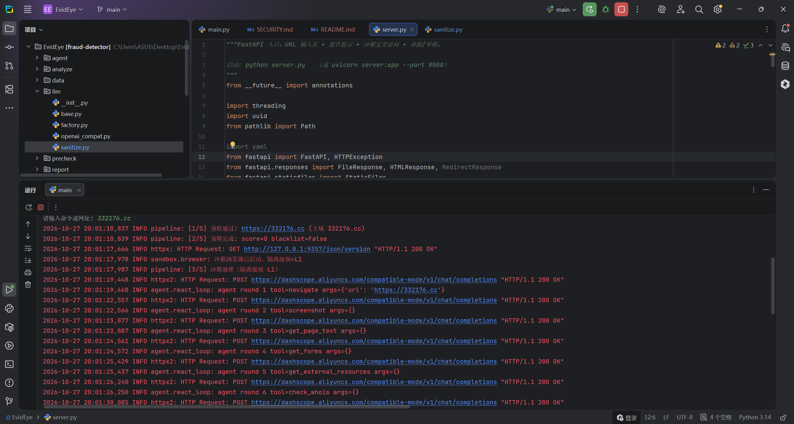
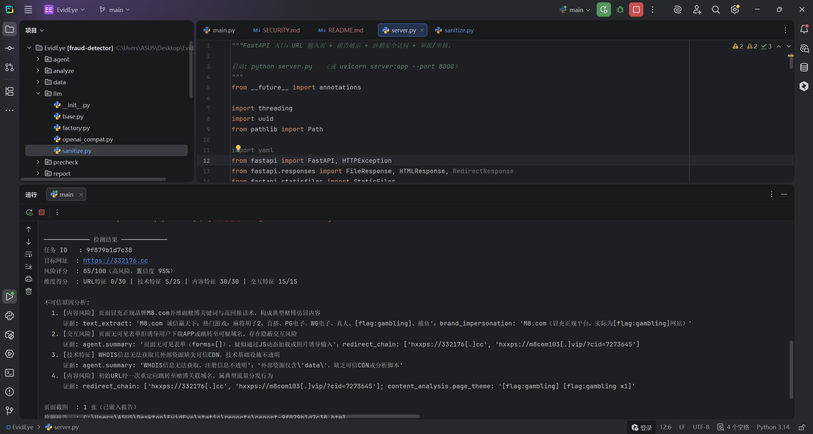
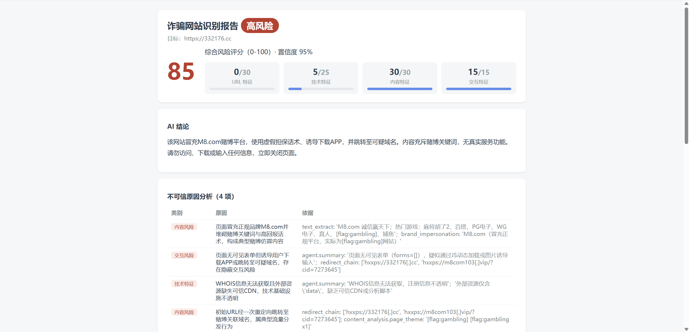
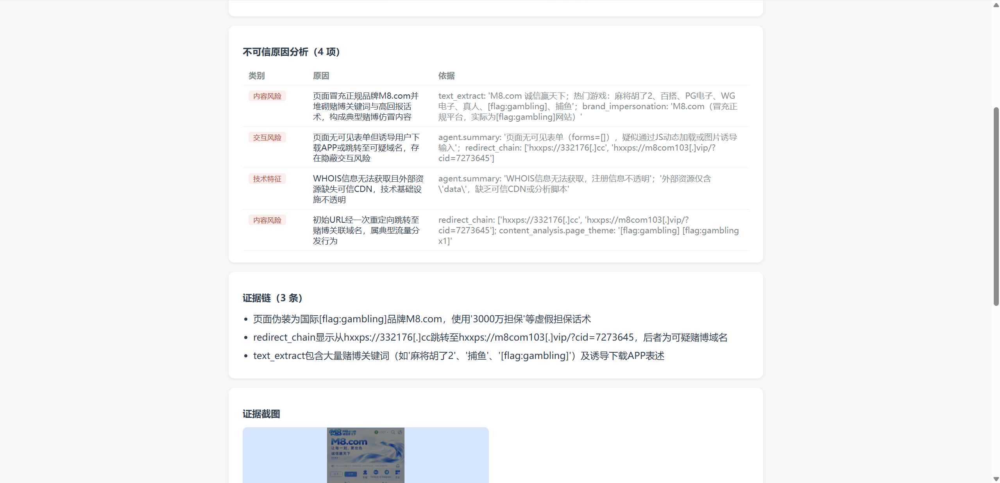
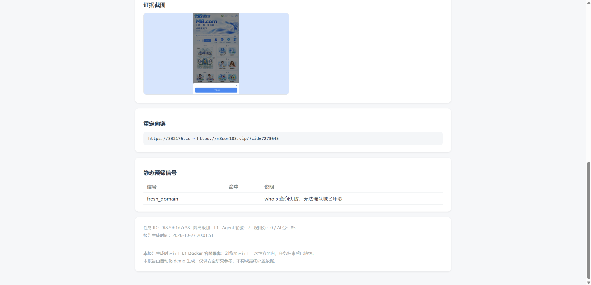

# EvidEye

**An LLM agent that audits a suspicious web page inside a disposable container and returns an evidence report — not just a label.**

Most phishing detectors answer one question: *is this URL malicious?* EvidEye asks a different one: *what did this page actually do, and can a third party check that claim afterwards?* Every verdict it produces is backed by an artifact the agent really observed — a form that posts to a third-party domain, a redirect chain, a screenshot, a WHOIS record, an intercepted submit request — stored and rendered next to the conclusion.

Status: research prototype. Runs end to end today, backed by the Qwen API (DashScope); a locally deployed model is a config change away. Single-page scope, no trained model, no commercial feeds.

---

## What it does

Given one URL, EvidEye:

1. **Checks it cheaply first.** URL syntax and SSRF guard → known-fraud database lookup → static prefilter (domain age, suspicious TLD, keyword patterns). A database hit returns a verdict in milliseconds with zero LLM tokens.
2. **Audits it in a sandbox.** A containerised Chromium is driven over CDP by a ReAct agent with eight forensic tools. The page is treated as hostile input: no downloads, no real credentials, no successful form submissions.
3. **Scores and explains it.** Rule-based signals and a multimodal LLM judgement are merged into four dimensions, and the result is rendered as a standalone HTML report with the evidence attached.

```
URL
 │
 ├─[1] url_guard ............ syntax, scheme, SSRF / private-address rejection
 ├─[1.5] fraud_db .......... known-bad hit → verdict in ms, no model call
 ├─[2] static_filter ....... domain age, TLD, brand-in-subdomain, keyword score
 ├─[3] sandbox agent ....... Docker container + CDP + ReAct loop (8 tools)
 ├─[4] judge ............... rule score × LLM dimensions, merged
 └─[5] html_report ......... evidence-linked report + screenshots
```

## Why an agent, and why the evidence

A classifier gives you a probability. That is enough to block a link, and completely useless if you have to explain the decision to a bank's risk team, a registrar, or a court. What those audiences need is a *record of behaviour*: which form field asked for a card number, where the submit request was addressed, how many hops the redirect chain had, what the page looked like at the moment it asked for a one-time code.

So the agent's job is not classification — it is **executing a small forensic procedure and keeping the receipts**. The scoring layer is deliberately boring: rules for the things rules are good at (domain age, mismatched form action), a vision model for the things rules are bad at (a page that *looks* like a bank), and an explicit evidence list that ties each risk reason to the tool output that produced it.

## Architecture

| Layer | Component | Cost | Implementation |
|---|---|---|---|
| L0 | Static precheck + fraud DB | milliseconds | `precheck/`, `storage/db.py` |
| L1 | Sandboxed agent (Docker) | 1–5 min | `sandbox/browser.py` (`isolation: l1`), `agent/react_loop.py` |
| L2 | Hardened local browser | 1–5 min | `sandbox/browser.py` fallback — **hardening, not a sandbox** (see Limitations) |
| — | Scoring / report | seconds | `analyze/`, `report/` |

**Isolation.** In `auto` mode EvidEye probes the Docker daemon and uses an `mcr.microsoft.com/playwright/python` container, connecting to Chromium over CDP and destroying the container after the run. If Docker is unavailable it degrades to a locally launched browser with hardened flags — and states that downgrade in the report rather than pretending the run was sandboxed.

## The eight forensic tools

| Tool | What it returns | Why it matters |
|---|---|---|
| `navigate` | final URL, title, redirect chain | catches cloaking and open redirects |
| `get_page_text` | truncated visible text | the input for content signals |
| `get_forms` | fields, types, action domain vs page domain | the single strongest structural signal |
| `fill_form_test` | which fields accepted fake data, which were refused | reveals client-side validation and honeypots |
| `submit_intercepted` | request URL, method, aborted flag | **the submit is intercepted at the network layer via Playwright routing and never leaves the container** |
| `get_external_resources` | third-party scripts, iframes, beacons | shows who else is watching the page |
| `screenshot` | full-page screenshot | evidence for humans, input for the vision model |
| `check_whois` | registrar, creation date, age | a domain registered 6 days ago is a fact, not an opinion |

`finish` closes the loop. The loop is capped at 8 rounds; if the model never calls `finish`, the collected signals are still scored.

## Scoring

| Dimension | Weight | Signals |
|---|---|---|
| URL features | 30 | TLD, length, brand token in subdomain, punycode, IP host |
| Content features | 30 | brand impersonation, urgency language, credential requests, gambling / investment copy |
| Technical features | 25 | third-party form action, password field outside a login URL, plain HTTP, redirect count |
| Interaction features | 15 | fill/submit behaviour, honeypot fields, intercepted payload |

Final score 0–100 → `high` / `medium` / `low`, with confidence and a per-reason evidence list.

## Quickstart

```bash
git clone <this repo> && cd EvidEye
python -m venv .venv && source .venv/bin/activate   # Windows: .venv\Scripts\activate
pip install -r requirements.txt
playwright install chromium        # only needed for the L2 fallback

export DASHSCOPE_API_KEY=sk-...    # any OpenAI-compatible endpoint works, see config.yaml
python main.py                     # interactive CLI
# or
python server.py                   # web UI on http://127.0.0.1:8000
```

Docker is required for L1 isolation. The image is pulled automatically on first run (~1 GB); if the daemon is not running, EvidEye falls back to L2 and says so in the report.

### What you get back

The block below is schematic; the next section shows a real run, image by image.

```
──────────── 检测结果 ────────────
任务 ID   : 3f9c1a2e
目标网址  : hxxp://bank-verify-account[.]click/login
风险评分  : 92/100（高风险，置信度 88%）
维度得分  : URL特征 28/30 | 技术特征 23/25 | 内容特征 30/30 | 交互特征 11/15

不可信原因分析:
  1. [表单劫持] 登录表单提交至第三方域名 collect[.]example-cdn[.]top
     证据: get_forms → action=https://collect.example-cdn.top/p.php, 页面域=bank-verify-account.click
  2. [域名可疑] 主域注册于 6 天前，使用 .click TLD
     证据: check_whois → creation_date=2026-10-21, registrar=NameSilo
  3. [内容仿冒] 页面复制某银行登录页文案，并要求输入短信验证码
     证据: get_page_text + screenshot（见报告）

检测报告  : static/reports/3f9c1a2e.html
──────────────────────────────────
```

The HTML report at `static/reports/<task_id>.html` is the actual product: screenshots, redirect chain, signal table, per-reason evidence, and a footnote stating which isolation level the run used.

## A real run, end to end

One complete audit of a live brand-impersonation gambling page (`hxxps://332176[.]cc`, captured 2026-10-27). The UI copy is Chinese; the engine is language-agnostic. URLs are defanged in the text — treat every host mentioned here as live and hostile, and do not visit them from a machine you care about.

**1 — The agent at work.** The ReAct loop drives the page one tool per round: `navigate` → `screenshot` → `get_page_text` → `get_forms` → `get_external_resources` → `check_whois`. Each round and its arguments are logged, which makes the run reproducible after the fact:



**2 — The verdict.** 85/100 (high), confidence 95%. Look at the dimension split: **URL features scored 0/30** — the domain itself is unremarkable. The score comes from content (30/30) and behaviour (15/15), which is precisely why a URL or keyword blocklist would have waved this page through:



**3 — The report.** Each risk reason carries a `依据` (basis) column that cites the tool output which produced it — form list, redirect chain, WHOIS response — rather than a model assertion:



**4 — The evidence chain.** Three pieces of evidence, each traceable to a stored artifact. Note the model's own summary uses the cloud-mode placeholders (`[flag:gambling]`) from the de-identification section above — the report quotes the evidence store, not the model's paraphrase of it:



**5 — The record.** Redirect chain `hxxps://332176[.]cc` → `hxxps://m8com103[.]vip/?cid=7273645`, WHOIS unresolvable for the target domain, and the footer stating the run executed in an **L1 Docker container** with the container destroyed afterwards:



The detail worth dwelling on is in image 2: a domain with no URL-level signals, no blacklist hit, and an unresolvable WHOIS record still lands at 85 — because what convicted it was *behaviour* (impersonating the M8.com brand, funnelling users to an APP download, redirecting into a gambling domain). That is the argument for auditing what a page does instead of matching what it is called.

## Configuring the model

Everything model-related lives in `config.yaml`. Two providers ship by default:

```yaml
llm:
  provider: qwen          # or: local
  qwen:
    base_url: "https://dashscope.aliyuncs.com/compatible-mode/v1"
    api_key_env: "DASHSCOPE_API_KEY"     # keys are never stored in this repo
    text_model: "qwen-plus"
    vision_model: "qwen3-vl-plus"
  local:
    base_url: "http://localhost:11434/v1"   # Ollama / vLLM
    text_model: "qwen2.5:14b"
```

Both go through one OpenAI-compatible client (`llm/openai_compat.py`) behind a two-method interface (`chat`, `chat_with_image`). Switching to a local deployment is a config change, not a code change — which matters because the interesting experiments here (does obfuscation raise an auditor's false-positive rate?) should not depend on a paid API.

### Cloud today, local tomorrow — and why some words never reach the cloud

The plan is to run the model locally. That switch is already isolated in config (`provider: local`, Ollama or vLLM, no key), but cloud deployment imposes a second constraint that has nothing to do with the API shape: **hosted providers inspect what you send them.** A phishing kit's landing page is, by construction, full of exactly the vocabulary that content moderation is built to catch — gambling copy, adult copy, scam scripts. Send it raw and DashScope answers `data_inspection_failed` (HTTP 400), so the model receives *nothing* and the audit dies for transport reasons rather than analytical ones.

`llm/sanitize.py` is the adapter for that. Before any page text leaves the machine it is de-identified:

| Sent to the model (cloud mode) | Kept locally (evidence store) |
|---|---|
| `[flag:gambling x27] [flag:scam x9]` — category placeholders with counts | the original sentences, verbatim |
| `[contact:telegram]`, `[contact:wechat]` — channel kept, handle dropped | the original handles and account ids |
| `hxxp://bank-verify-account[.]click` — defanged URL | the live URL string |
| one `[flag:adult-line]` per explicit line, line count preserved | the lines themselves |
| everything else — title, layout, form structure, field names — untouched | same |

So the cloud model sees **structure and category density, not literal text**. That is enough to rank severity ("40 gambling hits, 6 contact handles, a password field posting cross-domain") but not enough to quote the page. Three-stage degradation handles the rest: sanitised text → if that is still refused, `profile_for_llm()` emits a statistical profile with no sentences at all → if the *agent loop* is refused mid-run, `ContentModerationError` is caught, the signals collected so far are kept, and the truncation is written into the report instead of being hidden.

Two things worth being precise about:

- **This is de-identification, not moderation evasion.** The raw page is stored in SQLite before sanitisation, the report renders from the store, and a human reviewer sees the untouched evidence. The transformation applies only to the copy in flight.
- **It is temporary scaffolding.** With a local model there is no inspector, so the layer is unnecessary: set `EVIDEYE_SANITIZE=0` and the page text goes in verbatim, and reports can quote it directly. The env switch exists for exactly that migration; leaving it on with a local backend costs you fidelity for no benefit.


## Design decisions worth arguing about

- **The page is untrusted data, never instructions.** The system prompt states that any imperative text found on the page is evidence to be analysed, not a command. Tool output is truncated and sanitised before it re-enters the model context.
- **Submissions are intercepted, not completed.** `submit_intercepted` registers a `route` handler *before* the click, aborts the request, and records the URL and payload that *would* have been sent. The data never leaves the container — which is what makes probing a live phishing kit ethically defensible.
- **SSRF is rejected before the browser starts.** Private ranges, loopback, link-local and non-HTTP schemes are refused in `precheck/url_guard.py`.
- **A known-bad hit costs zero tokens.** The fraud database is consulted before the agent runs, so repeat reports are nearly free.
- **Degradation is reported, not hidden.** If Docker is missing, the report says `isolation: L2` and the footnote explains what that does and does not guarantee.
- **De-identification belongs to the transport layer, not the evidence layer.** Raw page text is persisted first and sanitised only on the outbound copy, so switching models (or switching this layer off) can never change what the evidence record says.

## Limitations

These are real and worth stating plainly:

- **L2 is not a sandbox.** The fallback is a hardened browser profile on the host. It reduces risk; it does not contain a browser exploit. Only L1 gives you containment.
- **Single-page scope.** No crawling, no site graphs, no cross-page correlation.
- **No trained classifier.** Scoring is rules plus an LLM judge. There is no labelled corpus, no precision/recall figures, and therefore no accuracy claim in this README.
- **No threat-intelligence feeds.** The bundled blacklist (`data/blacklist.txt`) contains placeholder domains. Certificate-transparency monitoring, registrar feeds and user reports are designed but not implemented.
- **In cloud mode the judge reasons over abstractions, not literal prose.** The model sees `[flag:gambling x27]`, not the twenty-seven sentences. Severity and topic still come through; quotation does not. The evidence store keeps the original text, so the report and a human reviewer are unaffected — but any claim about what the model "read" should be read with this in mind. Closing this gap is the main motivation for moving the model on-premises.
- **A hosted model can still refuse.** If a page trips the provider's filter even after de-identification, the run degrades to a statistical profile; if the agent loop itself is refused, the loop stops early. Both are recorded in the report rather than silently swallowed, but they do mean a cloud-mode result can be built on less evidence than the same page audited locally.
- **Chinese-language reports.** The UI and report copy are in Chinese; the engine is language-agnostic.

## Repository layout

```
agent/       ReAct loop, system prompt, tool dispatch
sandbox/     Docker/CDP browser, eight forensic tools, interactive safe-browse session
precheck/    URL guard (SSRF), static prefilter
analyze/     rule scoring, LLM judge, report moderation queue
llm/         provider interface, OpenAI-compatible client, cloud-mode de-identification (switchable)
storage/     SQLite schema and access (tasks / evidence / llm_calls / reports / fraud_db)
report/      Jinja2 HTML report
main.py      interactive CLI        server.py   FastAPI app + web UI
docs/        screenshots of the real run shown above
tests/       pytest smoke and end-to-end tests (mock provider)
```

No database, screenshot, or credential is committed: `.gitignore` excludes `data/*.db`, `static/evidence/` and `static/reports/`.

## Responsible use

This is a research instrument for **auditing pages you own or are authorised to investigate**. It deliberately refuses to complete submissions and aborts probing requests at the network layer. Do not point it at third-party sites without permission; do not lift the interception to turn it into a scanner. See [SECURITY.md](SECURITY.md).

## License

Apache-2.0. See [LICENSE](LICENSE).

## Author

Xiang Li — MSc in Computer and Information Engineering, City University of Hong Kong.
Built as a research prototype on evidence-grounded auditing by LLM web agents. Questions, criticisms and counter-examples are welcome: [shawnlee0803@163.com].
